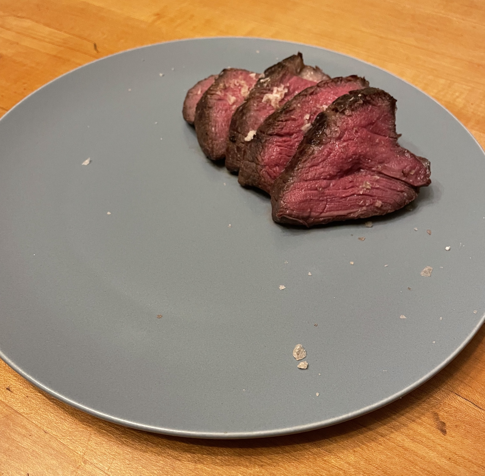
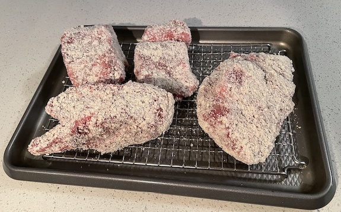
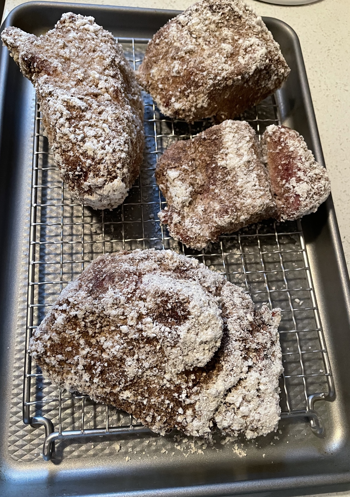
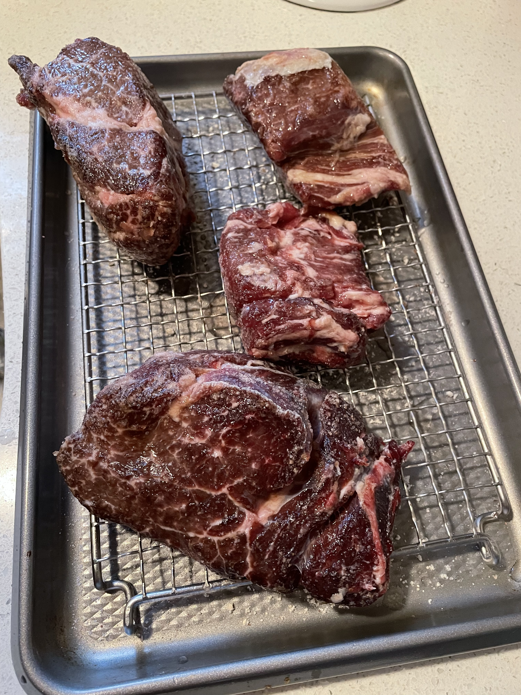
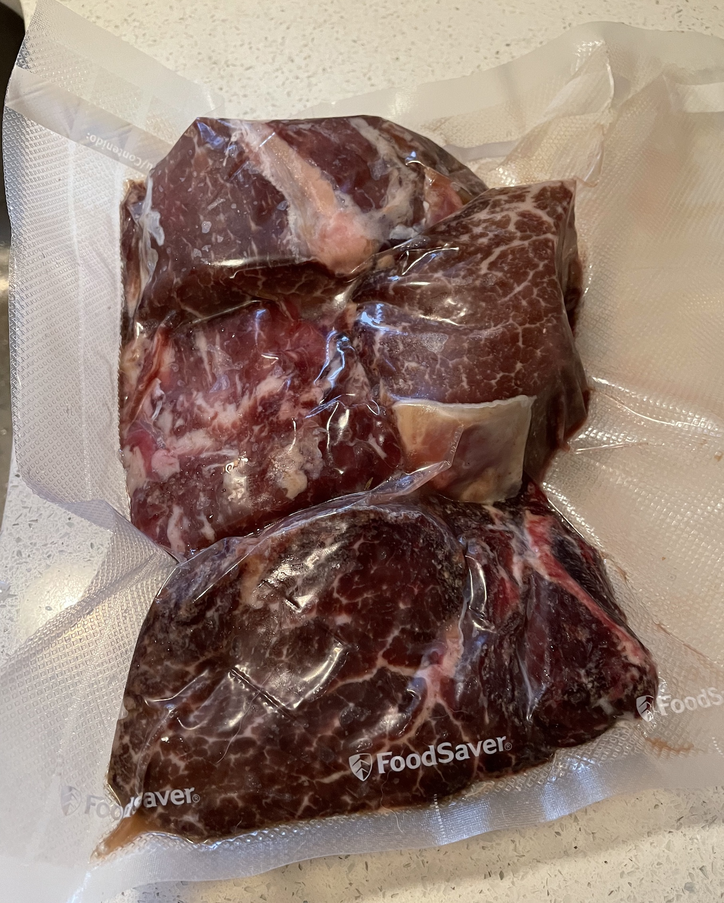
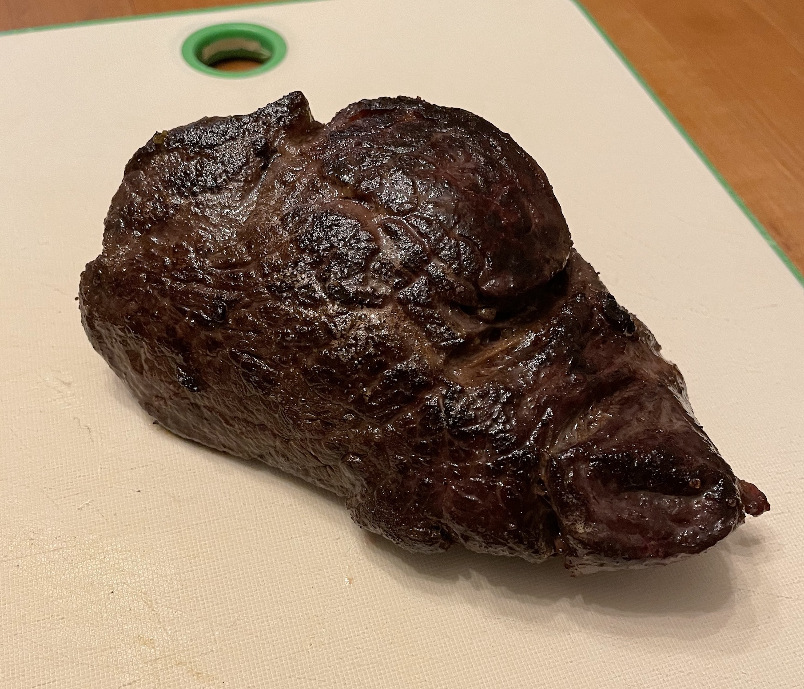

 
# Overview
I've been a huge sous vide fan for nearly half a decade now. I know sous vide tends to be a bit fiddly with its extra work to vacuum seal, long wait time, and extra required equipment but I am totally sold on the level of tenderness I can achieve with the long controlled cooking times at exactly the doneness that I want. 

I've convinced myself that after 7 years of sous vide-ing steaks, I've mastered producing medium rare, very tender steaks. Now it is time to really go after pushing the steak flavor boundaries. 

Typically I keep my steak seasonings simple: salt, pepper, butter, garlic, and a fresh herb (rosemary or thyme). While these flavors are great, I've always been curious about the flavors produced by dry aging. 

Dry aging *can* be done at home but seems to require even more specialized equipment to get it right. Additionally, good dry aging takes time. Often the aging process takes a month up to several months. While this wait time is easily managed in restaurants with dedicated meat lockers, it isn't very sustainable in a residential fridge. 

## Enter Koji Mold
There is plenty of buzz on the [internet](https://www.youtube.com/watch?v=xB4GcSiSQg0) about using a mold commonly known as koji (scientifically/formally known as aspergillus oryzae) for a variety of cooking purposes ranging from quick pickles, marinating fried chicken, and mimicking dry aging in steaks. 

Traditionally, by the way, this koji mold is typically used to break down rice for fermentation in the sake or miso-making process. 

For dry-aging steak, we're leveraging enzymatic action produced by the mold as it proliferates on the outside and inside of our steaks to break down proteins inside the meat. These fancy microbiological interactions result in a tenderization of the meat as well as the development of complex flavor compounds. More great info can be found [here](https://www.popsci.com/cook-steak-koji-fungus/).

## The process I followed
After watching a few youtube videos on mimicking dry-aging with koji, I learned that the general process goes as follows:
- Buy Koji (I bought mine from [Amazon](https://www.amazon.com/gp/product/B004FH67ZQ/ref=ppx_yo_dt_b_asin_title_o01_s00?ie=UTF8&psc=1))
- Blend the Koji into a fine powder with a blender
 
- Coat the outside of your steaks with this fine powder
- Place your koji coated steaks on a wire rack over a sheet pan in the fridge
- Leave the steaks in the fridge for 48 to 76 hours  (I did 76 hours)

- After 48 to 76 hours, remove your steaks from the fridge, rinse the koji off

- Dry the steaks
- Season them to your preference (I just used salt and pepper)

- Vacuum bag your steaks
- Cook the steaks sous vide at 130*F (For medium rare) for 1.5 hours
- Remove the steaks from the sous vide bath and take them out of the vacuum bag 
- Thoroughly dry the steaks   
- Sear in a cast iron pan to your heart's content

## Closing thoughts
These steaks were freaking delicious! I don't think this whole koji process really adds that much more difficulty or trouble into the typical sous vide steak preparation pipeline. 

In my opinion, these steaks ended up with a nutty flavor which was reminiscent of white cheddar cheese. 

Now I need to try some actually dry-aged steaks as a comparison.

I'll definitely be trying this method again and am excited to try other proteins!